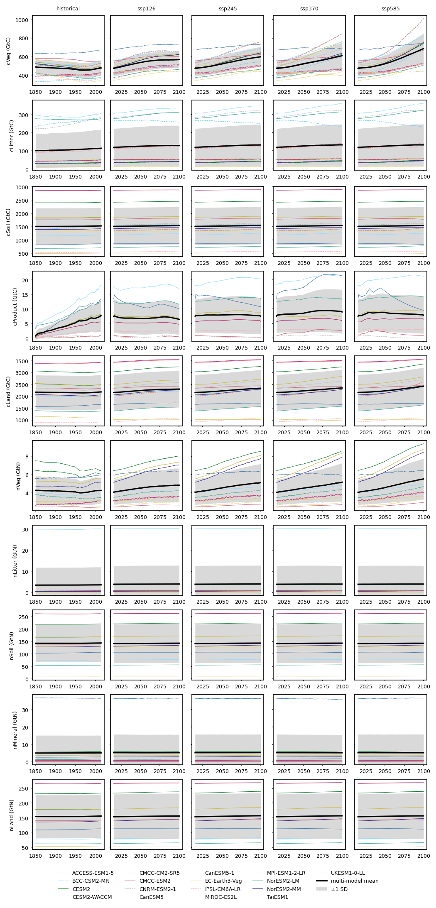
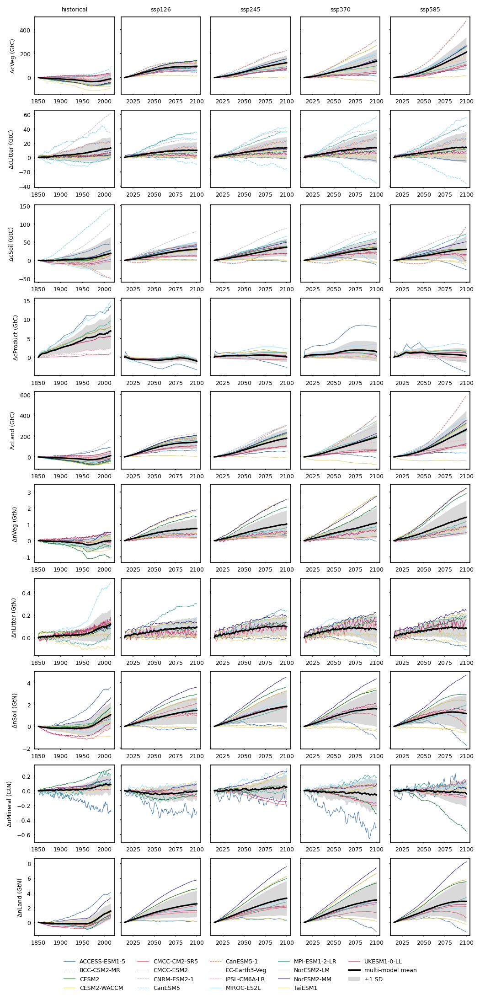
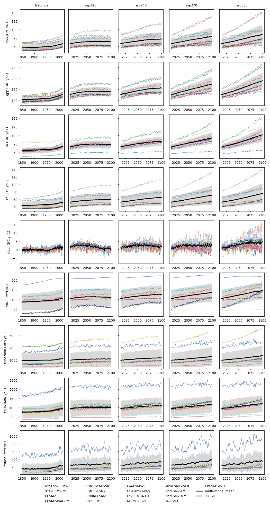

# Processed CMIP6 Earth System Model Carbon–Nitrogen Cycle Data

## Overview

This repository documents the processing workflow used to derive annual gridded and
annual global land-integrated carbon–nitrogen cycle data from original CMIP6
Earth system model (ESM) monthly output.

The development of this dataset was motivated by the development of CNit (Carbon–Nitrogen Interactions in Terrestrial ecosystems; see [CNit documentation](https://cnit.readthedocs.io); [Tang et al., 2025a](https://doi.org/10.5194/gmd-18-2193-2025), [2026a](https://doi.org/10.1029/2025MS005270), [2026b](https://doi.org/10.1038/s43247-026-03736-0), [2026c](https://doi.org/10.22541/essoar.15006117/v2)), the coupled carbon–nitrogen cycle model for MAGICC (Model for the Assessment of Greenhouse Gas Induced Climate Change; see [MAGICC repository](https://gitlab.com/magicc/magicc); [Meinshausen et al., 2011](https://doi.org/10.5194/acp-11-1417-2011)). During the processing and analysis of ESM output, we identified notable mass-conservation issues that prevented the direct calibration of CNit, which strictly conserves carbon and nitrogen mass. Through investigations involving ESM teams and analysis of the model output, we found that these issues are related to the way carbon and nitrogen pools and fluxes are reported in ESM output. Based on these findings, we have provided recommendations for future data providers, data users, and different MIPs. Further details are provided in [Tang et al., (2025b)](https://doi.org/10.5194/gmd-18-2111-2025) and the accompanying [community technical report](https://doi.org/10.5281/zenodo.17176344).

The processed dataset (**17 ESMs across the 1pctCO2 series, historical, and SSP scenarios**) can support a range of applications, including calibration and evaluation of simple climate models (SCMs) at both spatially resolved and global-integrated scales, intercomparison of terrestrial carbon–nitrogen cycle states and fluxes across ESMs, analysis of carbon–nitrogen cycle responses across experiments and scenarios, and evaluation of model consistency and mass conservation. The dataset also provides a standardized annual-resolution basis for analysing the variation and temporal evolution of terrestrial carbon and nitrogen pools and fluxes across CMIP6 ESMs.

## Data Processing

The source code for data processing and preliminary plotting is provided as Jupyter notebooks, all located in the `notebooks` directory:

* **Prepare land area** (`000_get_land_area_related.ipynb`): Original CMIP6 model-specific grid-cell area (`areacella`) and land fraction (`sftlf`), together with the resulting land area (`areacella × sftlf`), are compiled into Python dictionaries for later use.

* **Monthly-to-annual aggregation** (`001_process_to_annual_data.ipynb`): Original CMIP6 monthly data are processed to annual data.
  * State variables are aggregated as annual means (e.g., annual mean `cLand` on grids).
  * Flux variables are aggregated as annual totals (e.g., annual total `npp` on grids).
  * The monthly-to-annual aggregation is **weighted by the number of days in each month, using the original calendar** provided in the monthly CMIP6 data.
  * Flux variables originally reported in kg m-2 s-1 are converted to annual totals in kg m-2 yr-1.
  * For idealised experiments, some models report years 001–150 or 101–250, while most models use 1850–2000. To make the experimental periods consistent, **model experimental years beginning with 001 or 101 are shifted so that the first year corresponds to 1850**.

* **Annual global totals (land-integrated)** (`002_process_to_global_annual_data.ipynb`): The annual gridded data are combined with model-specific land area to obtain annual global land-integrated quantities.
  * In some cases, the model-specific `areacella`, `sftlf`, and variable datasets have slightly different `lat` and `lon` coordinate values, although they have the same spatial resolution. This is likely due to numerical precision. When using Xarray for calculations, the `lat` and `lon` coordinates must match exactly; otherwise, the results may be incorrect. Therefore, the `lat` and `lon` coordinates of the land-area data and gridded annual data are made consistent before global integration.
  * Units for the annual global totals are: **GtC** and **GtC yr-1** for carbon pools and fluxes, respectively; **GtN** and **MtN yr-1** for nitrogen pools and fluxes, respectively.

* **Plotting** (`003_plot_global_annual_data.ipynb`): Provides functions for plotting and visualising the annual global totals.

## Data Distribution

These notebooks produce the datasets in the `processed` directory, which include three components:

* **Land-area-related data** (`land_area_related/multiple pkl files`): Python dictionaries containing model-specific grid-cell area (`areacella`), land fraction (`sftlf`), and derived land area.

* **Annual gridded data** (`annual_data/multiple nc files`): CMIP6 carbon–nitrogen cycle variables processed from monthly to annual resolution on the original model grids.

* **Annual global totals (land-integrated)** (`global_annual_data/CMIP6_ESM_carbon_nitrogen_cycle_outputs_global_annual_processed_by_Gang_Tang.nc`): Annual global land-integrated quantities derived from the gridded data using model-specific land area.

The dataset includes carbon–nitrogen cycle variables from **17 ESMs** across the 1pctCO2 series of experiments, as well as historical and SSP scenarios. The surface air temperature variable `tas` is also included for convenience in analysing carbon-cycle feedbacks.

The processed dataset is distributed through [Zenodo](https://doi.org/10.5281/zenodo.24366086).

## Quality Control and Corrections

The resulting annual global totals were checked for anomalous values in key state and flux variables.

* **Initial-year state-variable anomalies**
    * Some experiments showed anomalous values in the first year, resulting in abrupt jumps between **1850 and 1851** or **2015 and 2016**.
    * Initial-year anomalies exceeding the following thresholds were identified:
        * **> 20 GtC** for carbon state variables
        * **> 0.2 GtN** for nitrogen state variables
    * The identified initial-year values were corrected using linear extrapolation from the following two years.

*  **NorESM2-LM `fNup`**
    *  The `fNup` flux in NorESM2-LM for the following experiments was found to have a substantially different magnitude from the other models:
        *  1pctCO2-bgc
        *  1pctCO2-rad
    *  The annual global totals were approximately **1e8 MtN yr-1** (unrealistic), compared with **<2000 MtN yr-1** for the other models.
    *  **The corresponding annual data were further examined at the grid level. The anomalous values were not identified as a simple numerical issue and could not be resolved by removing individual large values. Therefore, `fNup` for these two model–experiment combinations was set to `NaN`.**
    * **The underlying cause of the anomalous `fNup` values could not be identified or resolved. Consequently, the grid-level annual data for these two cases should be treated with caution.**

## Models, Experiments, and Variables

The dataset includes **17 Earth system models (ESMs)**:

* ACCESS-ESM1-5
* BCC-CSM2-MR
* CESM2
* CESM2-WACCM
* CMCC-CM2-SR5
* CMCC-ESM2
* CNRM-ESM2-1
* CanESM5
* CanESM5-1
* EC-Earth3-Veg
* IPSL-CM6A-LR
* MIROC-ES2L
* MPI-ESM1-2-LR
* NorESM2-LM
* NorESM2-MM
* TaiESM1
* UKESM1-0-LL

The dataset covers the following CMIP6 experiments:
* 1pctCO2
* 1pctCO2-bgc
* 1pctCO2-rad
* 1pctCO2Ndep
* 1pctCO2Ndep-bgc
* historical
* ssp119
* ssp126
* ssp245
* ssp370
* ssp434
* ssp460
* ssp585

The dataset contains carbon–nitrogen cycle variables and surface air temperature.

* **Carbon state variables**:

    * `cVeg` — vegetation carbon
    * `cLitter` — litter carbon
    * `cSoil` — soil carbon
    * `cProduct` — product carbon
    * `cLand` — total land carbon

* **Carbon flux variables**:

    * `gpp` — gross primary production
    * `npp` — net primary production
    * `ra` — autotrophic respiration
    * `rh` — heterotrophic respiration
    * `nbp` — net biome production
    * `rhLitter` — heterotrophic respiration from litter
    * `rhSoil` — heterotrophic respiration from soil
    * `fVegLitter` — carbon flux from vegetation to litter
    * `fLitterSoil` — carbon flux from litter to soil
    * `fVegSoil` — carbon flux from vegetation to soil
    * `fProductDecomp` — carbon flux from product decomposition
    * `fFire` — carbon flux from fire
    * `fFireNat` — carbon flux from natural fire
    * `fVegFire` — carbon flux from vegetation fire
    * `fLitterFire` — carbon flux from litter fire
    * `fGrazing` — carbon flux from grazing
    * `fHarvest` — carbon flux from harvesting
    * `fHarvestToProduct` — carbon flux from harvesting to products
    * `fHarvestToAtmos` — carbon flux from harvested products to the atmosphere
    * `fDeforestToProduct` — carbon flux from deforestation to products
    * `fDeforestToAtmos` — carbon flux from deforestation to the atmosphere
    * `fLuc` — land-use change carbon flux
    * `fAnthDisturb` — carbon flux from anthropogenic disturbance
    * `fCLandToOcean` — carbon flux from land to ocean
    * `netAtmosLandCO2Flux` — net CO₂ flux between the atmosphere and land

* **Nitrogen state variables**:

    * `nVeg` — vegetation nitrogen
    * `nLitter` — litter nitrogen
    * `nSoil` — soil nitrogen
    * `nProduct` — product nitrogen
    * `nMineral` — mineral nitrogen
    * `nLand` — total land nitrogen

* **Nitrogen flux variables**:

    * `fNup` — nitrogen uptake
    * `fBNF` — biological nitrogen fixation
    * `fNdep` — nitrogen deposition
    * `fNfert` — nitrogen fertilisation
    * `fNVegLitter` — nitrogen flux from vegetation to litter
    * `fNVegSoil` — nitrogen flux from vegetation to soil
    * `fNLitterSoil` — nitrogen flux from litter to soil
    * `fNnetmin` — net nitrogen mineralisation
    * `fNProduct` — nitrogen flux associated with products
    * `fNAnthDisturb` — nitrogen flux from anthropogenic disturbance
    * `fNleach` — nitrogen leaching
    * `fNgas` — gaseous nitrogen loss
    * `fNloss` — total nitrogen loss

* **Other variables**:

    * `tas` — surface air temperature

## Annual Global Total Plots

The figures below show annual global land-integrated totals for key carbon–nitrogen cycle state and flux variables from the 17 ESMs, providing a preliminary characterization of variation among models and changes over time.

* **Dashed coloured lines indicate models without an interactive nitrogen cycle (carbon-only ESMs), while solid lines indicate carbon–nitrogen coupled ESMs.**
* **Black lines and grey shaded areas indicate the multi-model mean and one standard deviation, respectively.**

#### Figure 1 Carbon and nitrogen state variables (magnitude of modelled land carbon and nitrogen pool sizes)


#### Figure 2 Changes in carbon and nitrogen state variables (land carbon and nitrogen accumulation or loss over time)


#### Figure 3 Carbon and nitrogen key flux variables


## Reproducing the Products

To reproduce the products, obtain the original CMIP6 model output from the Earth System Grid Federation ([ESGF](https://pcmdi.llnl.gov/CMIP6/)). These source data are not included in this repository. Arrange the input files as described in the processing notebooks. The notebooks also document model-specific data requirements, experiment definitions, and known limitations.

Create and activate the Conda environment from the repository root:

```sh
conda env create -f environment.yml
conda activate cmip6cn
```

Then launch Jupyter from the `notebooks/` directory. Run notebooks 000–002 in order to produce the data; notebook 003 is optional and plots the annual global totals:

```sh
cd notebooks
jupyter notebook
```

## Author and Contact

**Gang Tang**

* The University of Melbourne & The University of Sydney
* Email: [gang.tang.au@gmail.com](mailto:gang.tang.au@gmail.com) (primary); [gang.tang.1@unimelb.edu.au](mailto:gang.tang.1@unimelb.edu.au); [gang.tang@sydney.edu.au](mailto:gang.tang@sydney.edu.au)

## References

* Meinshausen, M., Raper, S. C. B., and Wigley, T. M. L.: Emulating coupled atmosphere-ocean and carbon cycle models with a simpler model, MAGICC6 – Part 1: Model description and calibration, Atmos. Chem. Phys., 11, 1417-1456, https://doi.org/10.5194/acp-11-1417-2011, 2011.
* Tang, G., Nicholls, Z., Norton, A., Zaehle, S., and Meinshausen, M.: Synthesizing global carbon–nitrogen coupling effects – the MAGICC coupled carbon–nitrogen cycle model v1.0, Geosci. Model Dev., 18, 2193–2230, https://doi.org/10.5194/gmd-18-2193-2025, 2025a.
* Tang, G., Nicholls, Z., Jones, C., Gasser, T., Norton, A., Ziehn, T., Romero-Prieto, A., and Meinshausen, M.: Investigating carbon and nitrogen conservation in reported CMIP6 Earth system model data, Geosci. Model Dev., 18, 2111–2136, https://doi.org/10.5194/gmd-18-2111-2025, 2025b.
* Tang, G., Zaehle, S., Nicholls, Z., Norton, A., Ziehn, T., and Meinshausen, M.: Understanding the Drivers of Carbon–Nitrogen Cycle Variability in CMIP6 ESMs With MAGICC CNit v2.0: Model and Calibration Updates, Journal of Advances in Modeling Earth Systems, 18, e2025MS005270, https://doi.org/10.1029/2025MS005270, 2026a.
* Tang, G., Nicholls, Z., Norton, A., Gasser, T., Ziehn, T., Zaehle, S., and Meinshausen, M.: Nitrogen limitation amplifies future warming by weakening terrestrial carbon cycle feedbacks and sink capacity, Communications Earth & Environment, https://doi.org/10.1038/s43247-026-03736-0, 2026b.
* Tang, G., Norton, A., Gasser, T., Nicholls, Z. R. J., Ziehn, T., Abrahão, G. M., and Meinshausen, M. A.: Reassessing the terrestrial carbon sink reveals stronger CO₂ fertilization, elevated climate sensitivity, and intensifying nitrogen limitation, ESS Open Archive, 2026, https://doi.org/10.22541/essoar.15006117/v2, 2026c.

## Citation

Tang, G. (2026). *Processed CMIP6 Earth System Model Carbon–Nitrogen Cycle Data* [Data set]. Zenodo. [https://doi.org/10.5281/zenodo.24366086](https://doi.org/10.5281/zenodo.24366086).

## License

The code, notebooks, and processed data products are licensed under [CC BY 4.0](https://creativecommons.org/licenses/by/4.0/).
